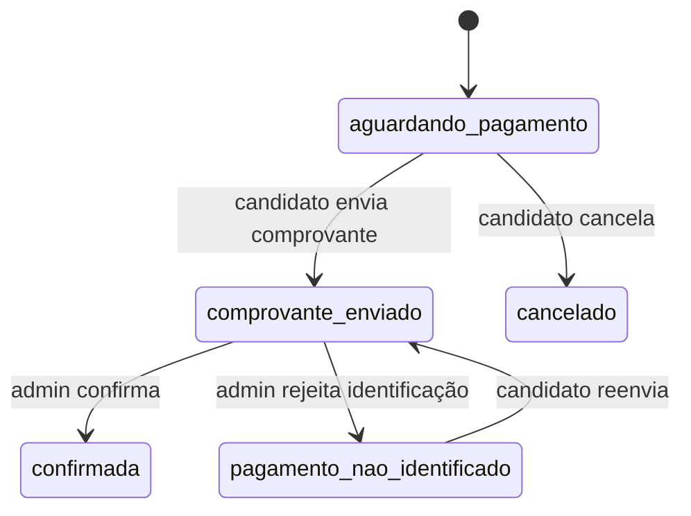
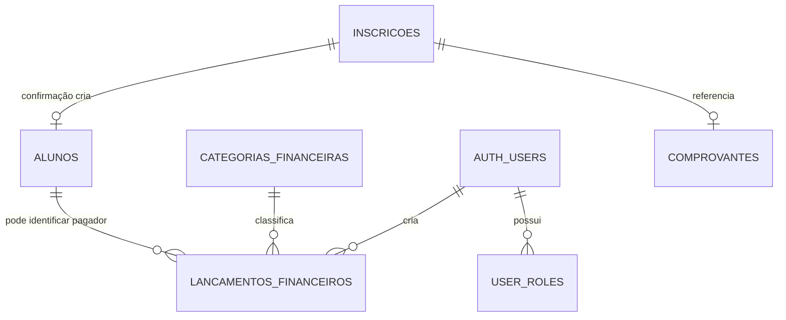

# Desenho do Controle Operacional

> Fonte da verdade arquitetural do **Controle Operacional** do ITS-Servo.
>
> Este documento separa explicitamente o que **já existe**, o que é
> **diagnóstico** e o que é **arquitetura-alvo**. Alterações estruturais na
> Central devem manter este desenho atualizado.
>
> Levantamento validado no repositório em **1º de outubro de 2026**.

## 1. Objetivo e conclusão executiva

O Controle Operacional é o sistema interno que recebe as solicitações originadas
no Site Institucional e conduz sua vida operacional: inscrição, pagamento,
comprovante, confirmação, aluno, financeiro, documentos e indicadores.

O desenho atual tem uma base coerente:

- dois produtos com fronteiras claras (`apps/site` e `apps/central`);
- uma Central organizada por capacidades de negócio;
- Supabase como backend compartilhado, com Postgres, Auth, RLS, Storage e Edge
  Functions;
- contrato público tipado para impedir que o Site conheça o banco;
- autosserviço protegido por token de posse e painel protegido por papel admin.

O próximo passo recomendado **não é criar microserviços nem reescrever a
aplicação**. É amadurecer o monólito modular existente, movendo regras críticas
para comandos transacionais no backend, registrando histórico, consolidando
tipos/regras duplicados e fazendo indicadores financeiros refletirem o caixa
real.

## 2. Contexto e fronteira de produto

O ITS-Servo é uma plataforma composta por dois produtos e uma fundação
compartilhada:

```mermaid
flowchart LR
    V[Visitante] --> SITE[Site Institucional\nAstro / SSG]
    SITE -->|solicitarInscricao| CONTRATO[@its-servo/supabase]
    CONTRATO --> EDGE[Edge Functions]
    EDGE --> DB[(Postgres)]

    C[Candidato] --> AUTO[Central: autosserviço\npúblico + token]
    AUTO -->|RPC / Edge Function| DB
    AUTO --> STORAGE[(Storage privado)]

    A[Equipe administrativa] --> PAINEL[Central: painel\nReact SPA]
    PAINEL -->|Supabase Auth + RLS| DB
    PAINEL --> STORAGE
```

| Responsabilidade | Site Institucional | Central Operacional |
|---|---|---|
| Conteúdo institucional e aquisição | Responsável | Não pertence; redireciona |
| Formulário de solicitação | Responsável pela UI | Recebe pelo contrato |
| Registro oficial, número e token | Não acessa | Responsável |
| Pagamento, comprovante e consulta | Não acessa | Autosserviço público com token |
| Confirmação e administração | Não acessa | Painel autenticado |
| Financeiro e indicadores | Não acessa | Responsável |

Regra de decisão: se a capacidade comunica e converte um visitante, pertence ao
Site. Se executa, controla, registra ou presta contas sobre a operação, pertence
à Central.

## 3. Arquitetura atual (AS-IS)

### 3.1 Estilo arquitetural

A solução é um **monorepo com dois frontends e um backend compartilhado**. A
Central é um **monólito modular no frontend**, apoiado por serviços gerenciados
do Supabase.

| Camada | Implementação atual | Responsabilidade |
|---|---|---|
| Produto público | `apps/site` | Conteúdo e solicitação de inscrição |
| Produto operacional | `apps/central` | Autosserviço e painel administrativo |
| Contrato compartilhado | `packages/supabase` | Client, tipos, núcleos e wrappers públicos |
| Identidade visual | `packages/design-system` | Tokens e estilos compartilhados |
| Backend | `supabase/` | Schema, RLS, RPCs, triggers, storage e funções |

### 3.2 Estrutura da Central

```text
apps/central/src/
├── service/
│   ├── inscricao/       # autosserviço e operação administrativa
│   ├── financeiro/      # livro-caixa, alunos, categorias e relatórios
│   └── indicadores/     # dashboard operacional
├── painel/              # login e shell de navegação autenticada
├── shared/              # componentes e utilitários transversais
├── integrations/        # client Supabase da aplicação
└── components/ui/       # primitives visuais
```

`painel/` é uma casca técnica, não um domínio de negócio. As capacidades de
negócio ficam corretamente em `service/`. Essa separação deve ser preservada.

Dependências atuais relevantes:

- `indicadores` consome `useInscricoes` de `inscricao`;
- `financeiro/previsao` também interpreta dados de inscrições;
- a confirmação de uma inscrição aciona no banco a criação de um aluno;
- páginas e componentes ainda executam parte das mutações diretamente pelo
  client Supabase.

### 3.3 Superfícies e rotas

| Rota | Superfície | Proteção |
|---|---|---|
| `/inscricao/pagamento/:numero` | Pagamento e comprovante | Número + token de posse |
| `/consulta` | Consulta e cancelamento | Número + token de posse |
| `/painel/login` | Autenticação administrativa | Pública |
| `/painel` | Dashboard | Supabase Auth + papel `admin` |
| `/painel/inscricoes` | Gestão de inscrições | Supabase Auth + RLS admin |
| `/painel/financeiro` | Financeiro | Supabase Auth + RLS admin |
| Rotas institucionais | Redirecionamento | Enviadas ao Site |

Há duas formas de autenticação intencionalmente distintas:

- **admin:** sessão Supabase Auth e autorização por `user_roles`/`is_admin()`;
- **candidato:** token específico da inscrição, sem conta e sem sessão.

### 3.4 Capacidades implementadas

#### Inscrição

- criação server-side com validação, número sequencial e token com hash SHA-256;
- limite básico de tentativas por IP e bloqueio de CPF com inscrição ativa;
- consulta e cancelamento por RPC protegida por token;
- PIX e envio de comprovante por Edge Function;
- bucket privado e leitura administrativa por URL assinada;
- busca, filtro, impressão e alteração de status no painel;
- e-mails de recebimento de inscrição, comprovante e confirmação;
- criação automática de aluno quando a inscrição é confirmada.

Fluxo nominal de status:



Importante: o diagrama representa o fluxo de negócio esperado. Hoje o painel
admin apresenta todos os estados como opções e atualiza a tabela diretamente;
portanto, as transições administrativas não são validadas como máquina de
estados pelo backend.

#### Financeiro

- alunos vinculados à inscrição ou cadastrados manualmente;
- categorias de entrada e saída;
- lançamentos por data, competência, unidade, categoria e aluno opcional;
- relatório mensal imprimível;
- visão anual e saldo acumulado;
- previsão baseada nas inscrições;
- seed do histórico de 2026 com conferências na migration.

O livro-caixa usa `competencia` para o mês contábil e `data` para o dia real do
movimento. A unidade pode ser um núcleo, `correspondencia` ou `NULL` para um
movimento institucional geral.

#### Indicadores

- inscrições por estado, modalidade e núcleo;
- inscrições novas no mês;
- comprovantes aguardando análise;
- quantidade de inscrições confirmadas tratada visualmente como alunos ativos;
- “receita confirmada” calculada como inscrições confirmadas × preço padrão.

O último item é uma **estimativa comercial**, não receita realizada. Ele não
deve ser usado como indicador contábil.

## 4. Modelo de dados atual

| Recurso | Papel | Observação |
|---|---|---|
| `inscricoes` | Aggregate operacional da inscrição | Contém PII, status e referência do comprovante |
| `alunos` | Cadastro usado pelo financeiro | Pode nascer de inscrição confirmada ou ser legado manual |
| `categorias_financeiras` | Classificação de entradas/saídas | Administrável e desativável |
| `lancamentos_financeiros` | Livro-caixa | Atualmente permite criar, editar e excluir |
| `user_roles` | Autorização administrativa | Hoje o painel exige `admin` |
| `criar_inscricao_hits` | Apoio ao rate limit | Acessível apenas por service role |
| Bucket `comprovantes` | Arquivos de pagamento | Privado; admin usa URL assinada |

Relações principais:



O banco e suas migrations são a autoridade sobre persistência e autorização.
`packages/supabase` deve ser a autoridade sobre os tipos consumidos pelos apps.

## 5. Contrato de inscrição

O Site conhece somente uma fronteira estreita:

```text
solicitarInscricao(dto)
  -> { numero_inscricao, token, email_enviado }
```

O backend valida o DTO, cria o registro oficial, persiste apenas o hash do token
e retorna as credenciais de autosserviço. Depois disso, o fluxo pertence à
Central:

| Operação pública | Implementação | Garantia principal |
|---|---|---|
| Consultar | RPC `buscar_inscricao` | Número + token válido |
| Cancelar | RPC `cancelar_inscricao` | Token válido e estado pendente |
| Enviar comprovante | Edge `enviar-comprovante` | Token, estado, MIME e tamanho validados |

Regra invariável: acesso anônimo não lê nem altera `inscricoes` diretamente.

## 6. Segurança e consistência atuais

Pontos fortes:

- tabela de inscrições fechada ao acesso anônimo direto;
- token armazenado somente como hash;
- token preferencialmente trafegado no fragmento da URL;
- comprovantes privados;
- RLS admin nas tabelas operacionais;
- Edge Function de confirmação de e-mail valida o papel do chamador;
- validações críticas do funil público repetidas no servidor.

Limitações:

- a mudança administrativa de status e o envio do e-mail de confirmação são
  duas operações independentes; o status pode confirmar e o e-mail falhar;
- não existe histórico persistente das transições nem motivo/autor da mudança;
- uma unidade inválida não bloqueia mais a confirmação, mas pode impedir a
  criação automática do aluno e deixar correção manual pendente apenas em log;
- o financeiro permite exclusão física de lançamento, inadequada para uma
  trilha de prestação de contas madura;
- o modelo de autorização é binário (`admin` ou sem acesso), sem segregação de
  funções como operação, tesouraria e consulta.

## 7. Avaliação arquitetural

| Dimensão | Estado | Avaliação |
|---|---|---|
| Fronteira Site/Central | Boa | Separação clara e contrato público pequeno |
| Modularidade da Central | Boa base | Pastas por capacidade; faltam APIs internas explícitas |
| Segurança pública | Boa base | Token, RLS e storage privado corrigem os riscos principais |
| Regras de domínio | Frágil | Status, rótulos e transições estão espalhados entre UI e banco |
| Consistência transacional | Parcial | Alguns fluxos combinam update, trigger e e-mail sem comando único |
| Auditabilidade | Insuficiente | Não há histórico operacional e o caixa aceita exclusão física |
| Indicadores | Parcial | Cálculo client-side e receita estimada confundida com realizada |
| Escalabilidade | Adequada hoje | Consultas carregam coleções completas; exigirão paginação/agregação |
| Tipagem compartilhada | Parcial | Pacote existe, mas há client local e DTOs/regras ainda duplicados |
| Testes | Parcial | Cobrem contrato e fronteiras; faltam fluxos admin, RLS e financeiro |
| Documentação | Corrigida neste desenho | A fonte anterior havia sido removida e referências ficaram quebradas |

### Lacunas funcionais em relação ao objetivo operacional

Ainda não existem como conceitos persistidos de primeira classe:

- responsável por uma inscrição/processo;
- fila de pendências com prazo, prioridade e resolução;
- histórico de ações e transições;
- motivo obrigatório para rejeição, cancelamento ou ajuste;
- conciliação entre inscrição, comprovante e lançamento financeiro;
- fechamento mensal com estado, responsável e aprovação;
- indicador de receita realizada derivado do livro-caixa.

Essas lacunas devem ser resolvidas antes de ampliar a Central para gestão
acadêmica (notas, frequência, turmas ou AVA).

## 8. Arquitetura-alvo incremental (TO-BE)

### 8.1 Princípios

1. **Manter o monólito modular.** O porte atual não justifica microserviços.
2. **Frontend orquestra experiência; backend protege invariantes.**
3. **Comandos críticos são transacionais e auditáveis.**
4. **Financeiro registra correções, não apaga história.**
5. **Um conceito possui uma definição canônica.** Status, unidades e tipos não
   devem ser redeclarados em várias telas.
6. **Indicador operacional deve declarar sua fonte e semântica.** Estimativa e
   valor realizado não podem compartilhar o mesmo nome.
7. **Evoluir por extração, não por reescrita.** Cada melhoria deve caber em uma
   entrega pequena, testável e reversível.

### 8.2 Estrutura interna recomendada

Sem introduzir camadas cerimoniais, cada serviço deve expor uma API interna
clara:

```text
service/inscricao/
├── domain.ts            # tipos, estados, transições e rótulos canônicos
├── api.ts               # chamadas ao backend/repositório
├── queries.ts           # hooks de leitura
├── mutations.ts         # hooks de comando e invalidação de cache
├── pages/
├── components/
└── lib/

service/financeiro/
├── domain.ts
├── api.ts
├── queries.ts
├── mutations.ts
├── pages/
└── components/
```

Regras de dependência:

- páginas não devem montar queries Supabase complexas nem decidir transições;
- outros serviços importam somente a API pública do serviço, não arquivos
  internos de UI;
- `packages/supabase` concentra client e tipos do banco/contrato;
- validações de segurança e invariantes permanecem no backend, ainda que a UI
  também valide para melhorar a experiência.

### 8.3 Comandos críticos no backend

Priorizar um comando/RPC administrativo para alteração de status:

```text
alterar_status_inscricao(
  inscricao_id,
  status_esperado,
  novo_status,
  motivo
)
```

O comando deve, na mesma transação:

- validar a transição permitida;
- evitar sobrescrita concorrente com `status_esperado`;
- atualizar a inscrição;
- registrar o evento com autor, data e motivo;
- criar ou sinalizar a criação do aluno quando aplicável.

O e-mail é um efeito posterior. Para maior confiabilidade, deve ser registrado
como evento pendente e processado com retentativa, em vez de determinar o
sucesso da transação principal.

Para o financeiro:

- substituir exclusão física por estorno/cancelamento auditado;
- registrar quem criou, alterou ou estornou;
- introduzir um estado de fechamento mensal antes de bloquear alterações em
  competências encerradas.

### 8.4 Dados adicionais recomendados

Adicionar apenas quando a etapa correspondente for implementada:

- `inscricao_eventos`: status anterior/novo, motivo, autor e timestamp;
- `responsavel_id` ou uma atribuição operacional separada;
- `pendencias_operacionais`: tipo, entidade, prazo, prioridade e resolução;
- metadados de estorno nos lançamentos;
- `fechamentos_financeiros`: competência, unidade, estado e aprovadores;
- fila/outbox para notificações.

## 9. Plano de evolução priorizado

### P0 — Integridade e fonte da verdade

- [x] consolidar o desenho arquitetural e restaurar um caminho compatível para
  referências antigas;
- [ ] centralizar estados, rótulos e transições de inscrição;
- [ ] criar comando transacional de alteração de status com histórico;
- [ ] impedir exclusão física de lançamento e implementar estorno;
- [ ] separar no Dashboard “receita prevista” de “receita realizada”;
- [ ] cobrir transições, RLS e estorno com testes de integração.

### P1 — Organização e operação diária

- [ ] consolidar o client/tipos Supabase em `packages/supabase`;
- [ ] extrair queries e mutations das páginas/componentes;
- [ ] adicionar responsáveis, motivos e fila de pendências;
- [ ] tornar falhas na criação automática do aluno visíveis no painel;
- [ ] implementar retentativa e visibilidade das notificações.

### P2 — Prestação de contas e escala

- [ ] fechamento mensal com aprovação e bloqueio de competência;
- [ ] conciliação inscrição/comprovante/lançamento;
- [ ] agregações de indicadores no banco, baseadas no caixa real;
- [ ] paginação e filtros server-side para inscrições e lançamentos;
- [ ] papéis separados para operação, tesouraria e consulta.

### Fora do horizonte atual

Diário de classe, notas, frequência, AVA, mensagens internas e gestão
pedagógica completa. Essas capacidades constituem outro domínio e só devem ser
consideradas depois da consolidação operacional e financeira.

## 10. Critérios de arquitetura para novas funcionalidades

Uma nova funcionalidade só deve entrar quando responder claramente:

1. Qual serviço é dono do conceito?
2. Qual dado é a fonte da verdade?
3. Quem pode ler e alterar?
4. Qual regra precisa ser garantida no backend?
5. Qual histórico deve permanecer após a ação?
6. Como falhas parciais e retentativas ficam visíveis?
7. Qual teste comprova a regra?
8. O indicador resultante é estimado ou realizado?

## 11. Decisões registradas

| Decisão | Motivo |
|---|---|
| Manter Site e Central separados | Públicos, objetivos e ciclos de entrega distintos |
| Manter Supabase como backend | Atende ao porte atual e já concentra dados e segurança |
| Manter monólito modular | Menor custo operacional e fronteiras de domínio suficientes |
| Preservar autosserviço sem conta | Token por inscrição reduz atrito sem abrir PII |
| Tratar `service/` como fronteira de negócio | Evita organizar o sistema por telas genéricas |
| Adiar domínio acadêmico | Não ataca os gargalos operacionais prioritários |
| Evoluir o financeiro para trilha imutável | Prestação de contas exige histórico de correções |

## 12. Evidências do levantamento

Principais pontos do código usados neste mapeamento:

- rotas e superfícies: `apps/central/src/App.tsx`;
- módulos: `apps/central/src/service/`;
- autenticação: `painel/pages/Login.tsx` e `shared/components/ProtectedRoute.tsx`;
- contrato público: `packages/supabase/src/contract.ts`;
- dados e RLS: `supabase/migrations/`;
- operações públicas: `supabase/functions/criar-inscricao/` e
  `supabase/functions/enviar-comprovante/`;
- dashboard: `service/indicadores/pages/Dashboard.tsx`;
- financeiro: `service/financeiro/`.
